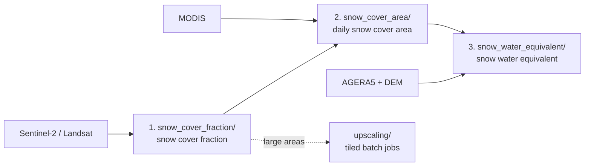

# openeo_mountains_snow
Snow processing in the mountains based on openEO.

Full method docs: [docs/](docs/index.md) (Quarto).

## Pipeline



| Term | Meaning |
|------|---------|
| SCF  | Snow cover fraction, 0–100 % per pixel |
| SCA  | Snow cover area, binary snow / no snow |
| SWE  | Snow water equivalent |
| CP   | Conditional probability (MODIS SCF → high-res snow) |

## Install

```bash
pip install -e .[dev]
```

## Run

| Step | Command | Config |
|------|---------|--------|
| SCF | `python -m openeo_mountains_snow.snow_cover_fraction.snow_cover_fraction +experiment=andes_snow_cover_fraction` | `conf/` (Hydra) |
| SCF UDP (writes JSON) | `python -m openeo_mountains_snow.snow_cover_fraction.udp.snow_cover_fraction_udp` | `conf/` (Hydra) |
| SCA reconstruction + SWE | `python -m openeo_mountains_snow.main` | `config.py` |
| Upscaling | `python -m openeo_mountains_snow.upscaling.run_upscaling [--preview]` | `upscaling/config.py` |
| Tests | `pytest` | |

## Layout

```
src/openeo_mountains_snow/
├── conf/            Hydra configs (config.yaml + experiment/*.yaml)
├── snow_cover_fraction/             Step 1: snow cover fraction
│   ├── udfs/        UDFs run on the backend
│   └── udp/         UDP builder + published JSON
├── config.py        Shared settings for main.py and upscaling
├── main.py          Runs snow cover area -> snow water equivalent as one batch job
├── snow_cover_area/ Step 2: daily snow cover area reconstruction (+ conditional probability)
│   └── udfs/
├── snow_water_equivalent/             Step 3: SWE + meteo downscaling
│   └── udfs/
├── upscaling/       Tile a large AOI into many batch jobs
├── experimental/    Prototypes, not part of the pipeline
└── senales_wgs84.geojson   Default AOI
docs/                Method documentation (Quarto)
test/                Tests
```

## Code rules

- **Client code** (`*.py` in a step folder) builds the openEO process graph locally.
- **UDFs** (`*/udfs/*.py`) are read as text and executed on the backend. Keep them
  self-contained: only import what the backend UDF runtime provides.
- **UDPs** (`*/udp/`) are generated JSON process definitions; regenerate, don't hand-edit.
